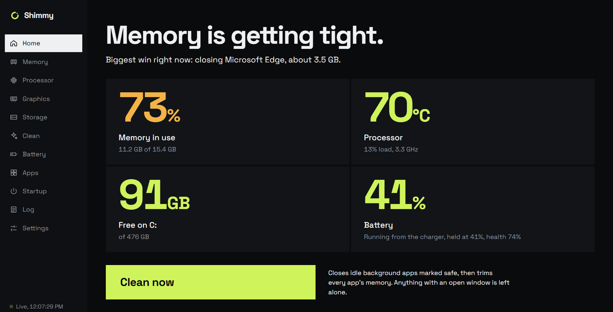
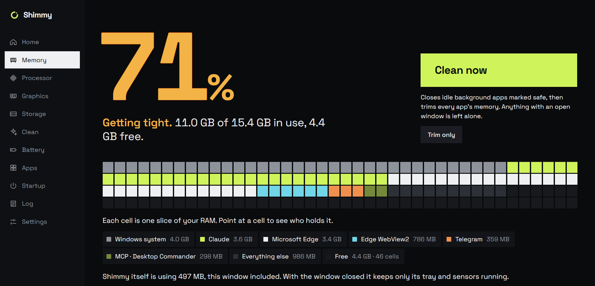
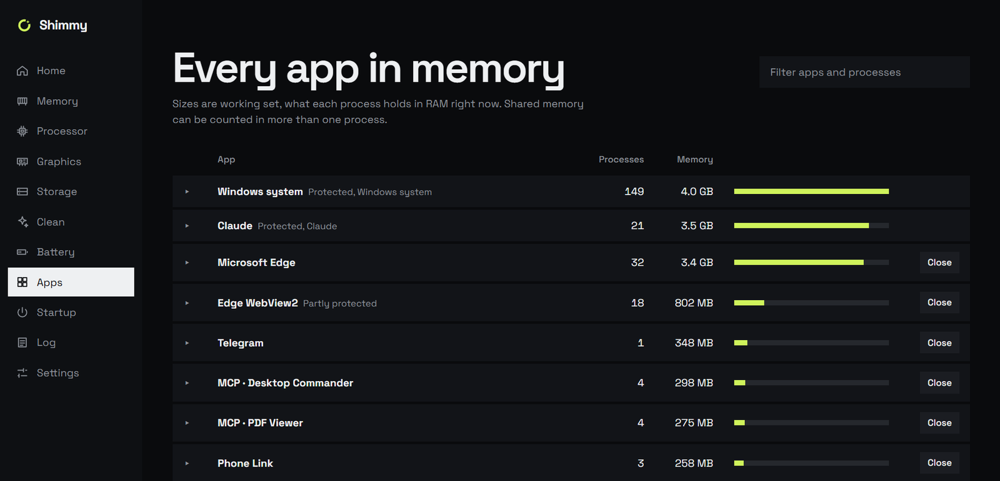
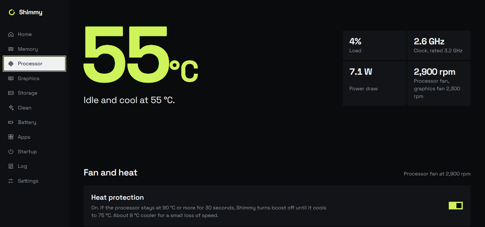
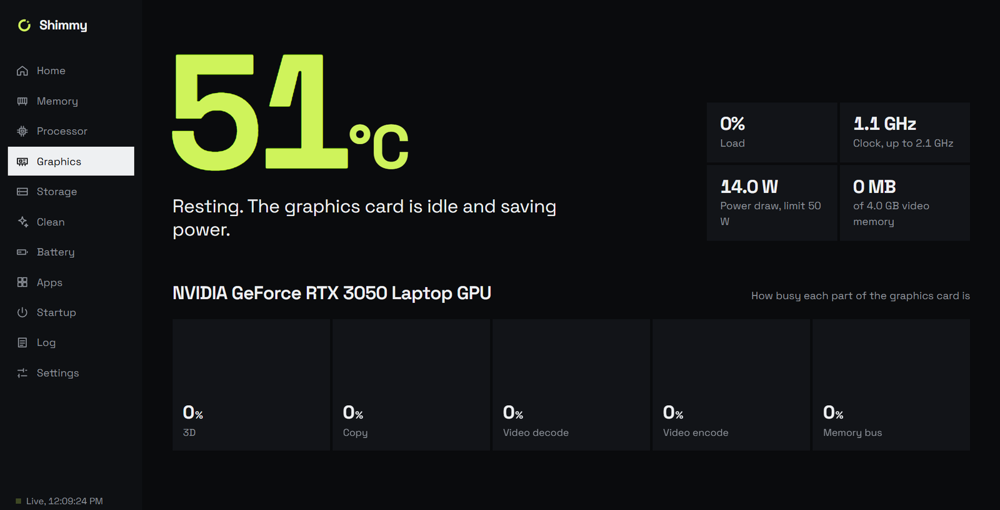
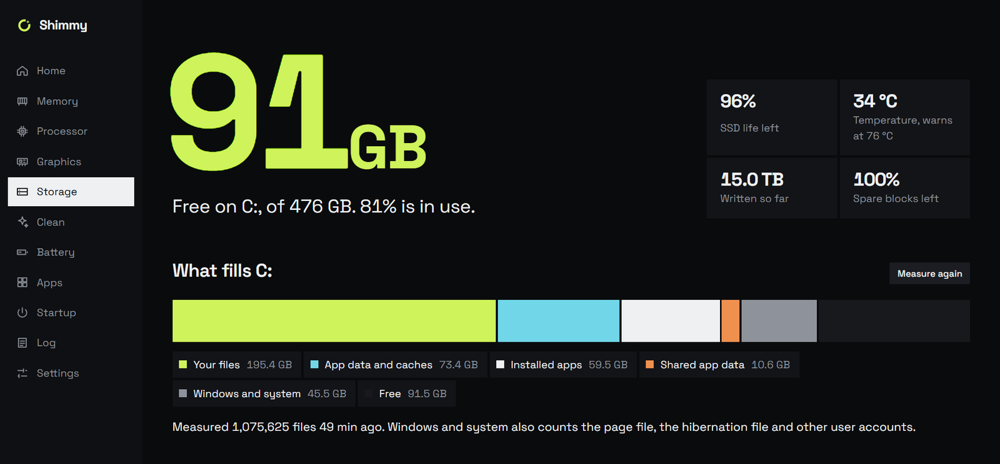
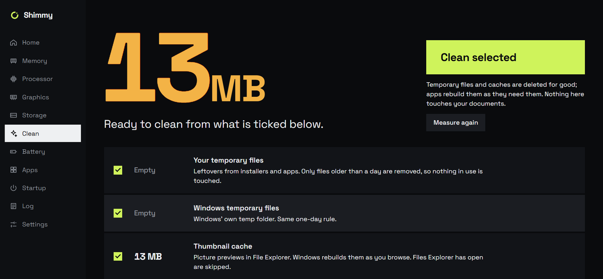
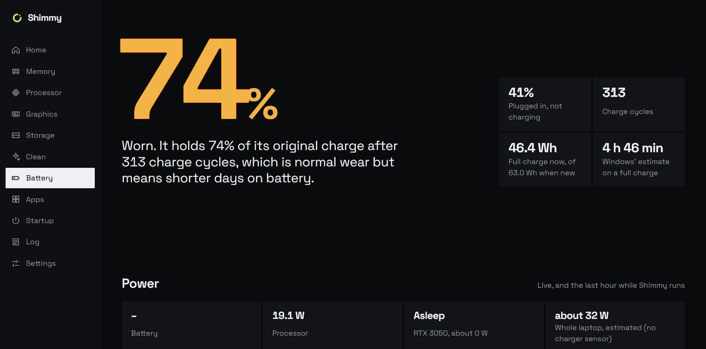
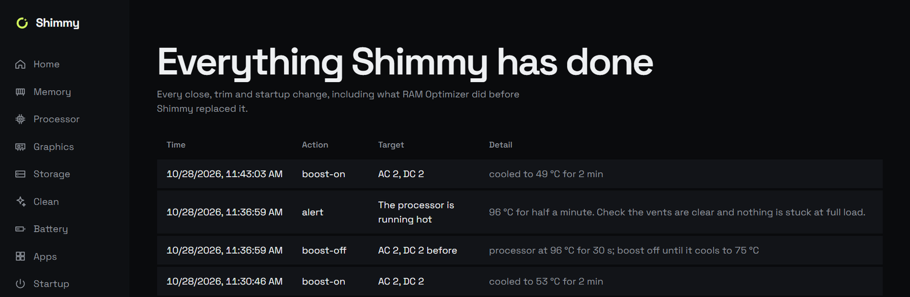
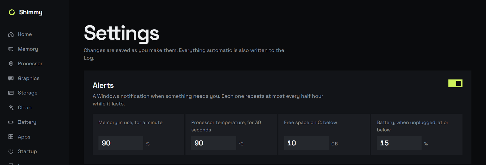

# Shimmy Optimizer

**A fast, honest system companion for Windows laptops: see what your machine is really doing, and fix it in one click.**

<p>
  <a href="https://github.com/Shimrith-Raj/Shimmy-optimizer/releases/latest/download/Shimmy-Optimizer-Setup.exe"></a>
  <a href="https://github.com/Shimrith-Raj/Shimmy-optimizer/releases/latest"></a>
  <a href="LICENSE"></a>
</p>

> **Looking for the .exe?** It isn't in the source code. The installer is attached to each
> [release](https://github.com/Shimrith-Raj/Shimmy-optimizer/releases/latest). The button above always downloads the newest
> one. See [DOWNLOAD.md](DOWNLOAD.md) for older versions and how to check the file.

Shimmy shows your RAM, CPU, GPU, storage and battery in one place, in plain language. You can clear memory hogs, reclaim disk
space safely, choose the fan mode, keep the processor cool, and stop wearing out your battery when you're plugged in.
It's written in Rust with Tauri 2. It sits in the tray using about 30 MB of memory and never deletes anything without asking.



## ⬇️ Install

**[Download Shimmy-Optimizer-Setup.exe](https://github.com/Shimrith-Raj/Shimmy-optimizer/releases/latest/download/Shimmy-Optimizer-Setup.exe)**
(Windows 10/11, 64-bit, about 8 MB)

1. Run the installer and click **Yes** when Windows asks for administrator rights.
2. Windows SmartScreen may say *"Windows protected your PC"* because the installer isn't code-signed yet. Click
   **More info → Run anyway**.
3. That's it. Shimmy opens, adds a tray icon next to the clock, and starts with Windows from then on. You can turn that off
   in Settings.

The installer also sets up [PawnIO](https://pawnio.eu), the signed driver Shimmy uses to read CPU temperature, clocks and
power. To uninstall, use **Settings → Apps → Installed apps → Shimmy Optimizer**. That removes Shimmy and its sign-in task.
PawnIO is listed separately, so you can remove it there too.

**Works on:** any Windows 10/11 PC for monitoring and cleaning. Fan modes and the battery charge limit appear on ASUS laptops
whose firmware exposes them, such as many Vivobooks; other PCs simply don't show those controls. GPU readings need an
NVIDIA card. Built and tested on an ASUS Vivobook M3500QC (Ryzen 7 5800HS, RTX 3050 Laptop, Windows 11). On other ASUS
models, Shimmy warns you once before its first firmware change and changes nothing unless you confirm.

---

## What it does

### 🧠 Memory
- A live map of every running app, grouped the way you think about them ("Chrome", not 40 processes)
- Suggestions on what is safe to close and how much it frees, with protected system and work apps never touched
- **Clean now** and **Trim** from the window or the tray, plus an optional automatic clean when memory stays full

<table><tr>
<td width="50%"></td>
<td width="50%"></td>
</tr></table>

### 🔥 Processor
- Real temperature, per-core clocks and power, through LibreHardwareMonitor
- **Fan modes:** Silent / Standard / Performance, the same ASUS modes as Fn+F, with the live fan speed
- **Heat protection:** if the CPU stays at 90 °C or more for 30 seconds, Shimmy turns CPU boost off until it cools.
  Measured on the Vivobook: **about 8 °C cooler under full load for about 0.5 % less clock speed.** Your original
  setting is always put back.
- Throttling detection in plain words ("Running at 2.1 GHz while busy, below its rated 3.2 GHz")



### 🎮 Graphics
- RTX temperature, load, VRAM and power through NVML, read **only while you're looking**, so the dedicated GPU can sleep
- Per-app GPU use across both chips, the same numbers as Task Manager



### 💾 Storage and Clean
- What fills C:, folder by folder, with safe deletes to the Recycle Bin
- Old caches (CapCut, Premiere, Telegram, Spotify, Discord, npm, pip, Cargo…) found by age, never while the app is open
- Big and duplicate file finder (BLAKE3 hashing) that skips code projects, hidden files and anything on your Keep list
- Temp files, Windows Update leftovers, browser caches (never history or passwords), DISM component cleanup

<table><tr>
<td width="50%"></td>
<td width="50%"></td>
</tr></table>

### 🔋 Battery
- Health, charge cycles and a capacity-over-time chart from Windows' own battery report
- **Charge limit** (60 / 80 / 100 %) through the ASUS firmware
- **Run from the charger:** while you're plugged in the battery neither charges nor drains, so the charger powers the
  laptop and the battery's charge cycles are saved
- **Live power:** watts in and out of the battery, CPU and RTX watts, the whole laptop's draw, and a one-hour chart that
  shows when the battery had to help the charger



### ⚙️ Everything else
- Startup apps on or off (including all-users entries), a full action log you can audit, alerts for memory, heat, disk
  and battery, a weekly automatic clean, and Start with Windows straight into the tray

<table><tr>
<td width="50%"></td>
<td width="50%"></td>
</tr></table>

---

## Built to be trusted

- **Nothing destructive without a gate.** Closing processes, deleting files and deleting folders each go through one
  unit-tested check. Deletes go to the Recycle Bin by default, and anything too big for the bin asks you a second time.
- **Everything is logged.** Every close, clean, delete, fan change and charge-limit write is written to a CSV log.
- **No server, and almost no network.** The UI talks to the Rust core over Tauri IPC with a capability allow-list, and
  the window itself cannot reach the network. The only network use is Shimmy reading GitHub's public release info and
  downloading the installer when you update; the daily check can be turned off in Settings. The installer's SHA-256 is
  checked before it runs, and nothing is ever uploaded.
- **Light when idle.** The window and its WebView are destroyed when you close it, so Shimmy uses about 30 MB in the tray.
- **Tested against reality.** Rust unit tests, a parity test against the app's previous version on a real 293-process
  snapshot, and read-only checks that run on the actual laptop.

---

## Tech

| Part | What |
|---|---|
| Shell | [Tauri 2](https://tauri.app), vanilla HTML / CSS / JS, Space Grotesk bundled locally |
| Core | Rust 2024: `windows`, `sysinfo`, `nvml-wrapper`, `trash`, `rayon`, `blake3`, `winreg` |
| Sensors | A small C# sidecar on [LibreHardwareMonitor](https://github.com/LibreHardwareMonitor/LibreHardwareMonitor) with the signed [PawnIO](https://pawnio.eu) driver |
| ASUS | ATK ACPI through `\\.\ATKACPI`: fan modes, fan speeds and the charge limit |
| Installer | NSIS, per-machine; installs PawnIO and a sign-in task that starts Shimmy elevated in the tray |

## Build it yourself

Most people should just use the installer above. To build from source, you need Windows 11, Rust 1.90+, Node.js and the .NET Framework 4 `csc.exe`, which comes with Windows and compiles the
sensor sidecar.

```bash
cd app
npm install
CARGO_TARGET_DIR=target-ship npx tauri build
```

The installer lands in `app/src-tauri/target-ship/release/bundle/nsis/`. Run the tests with:

```bash
cd app/src-tauri
SHIMMY_NO_ADMIN=1 CARGO_TARGET_DIR=target-dev cargo test
```

Shimmy runs as administrator, which it needs for the temperature sensors, the charge limit and system cleaning. The installer
is unsigned, so Windows SmartScreen will warn once.

## Docs

- [`PLAN.md`](PLAN.md): every phase, every decision, and the firmware experiments with their measured results
- [`CONTEXT.md`](CONTEXT.md): the code map and build notes

---

## Founder

Shimmy Optimizer was founded and is built by **Shimrith Raj**.

## Licence

Shimmy is released under the [MIT licence](LICENSE): free to use, change and share, as long as the copyright notice stays.
Third-party components keep their own licences. LibreHardwareMonitor is under MPL-2.0 and the PawnIO driver is under GPL-2.0
with an exception. Details are in [THIRD-PARTY-NOTICES.md](THIRD-PARTY-NOTICES.md).

By installing Shimmy you agree to its [Terms of Use](TERMS.md). The installer shows them before anything is installed.

*Shared as-is, without warranty. Use the ASUS controls at your own risk on models other than the one Shimmy was built on.*
